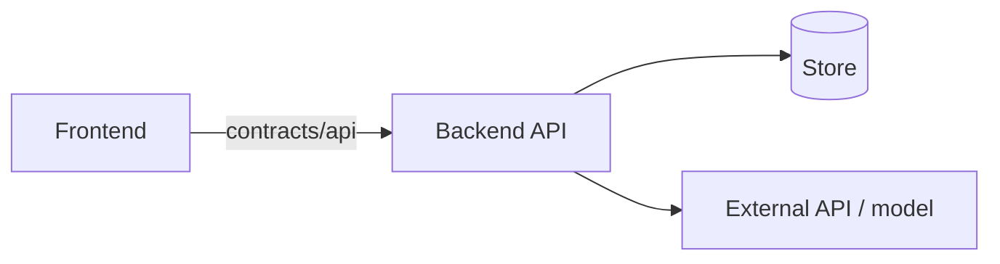

# Architecture

One page. Every agent reads this before starting a bead, so keep it current and short.

## What we're building

_Two sentences, matching `DEMO.md`._

## Components



| Component | What it does | Lives in | Lane |
|---|---|---|---|
| | | | |

## Lanes and ownership

Agents edit only their lane's directories. Shared files need a lock
(`bdh :aweb lock <path>`) or a mail to the owner first.

| Lane | Directories it owns | Human | Agents |
|---|---|---|---|
| | | | |
| shared | `contracts/` (coordinator only), `Makefile`, `.github/`, `scripts/` | __LEAD__ | __COORDINATOR__ |

## Data flow

_The main request path from the demo, step by step: user action → frontend → API →
store / external service → response._

## Contracts

_What's in `contracts/` and how each side uses it: the API schema, shared types, stubs._

## External services and keys

| Service | Used for | Env var | Fallback if it's down |
|---|---|---|---|
| | | | |

All keys are listed in `.env.example`. Never commit real values.

## How to run

```bash
# local dev
# tests: make test / make test-fast
# deploy: merges to main deploy automatically to <url>
```

## Decisions

_One line each, newest first: `- <decision> because <reason>`._

## Out of scope

_What we're explicitly not building._
